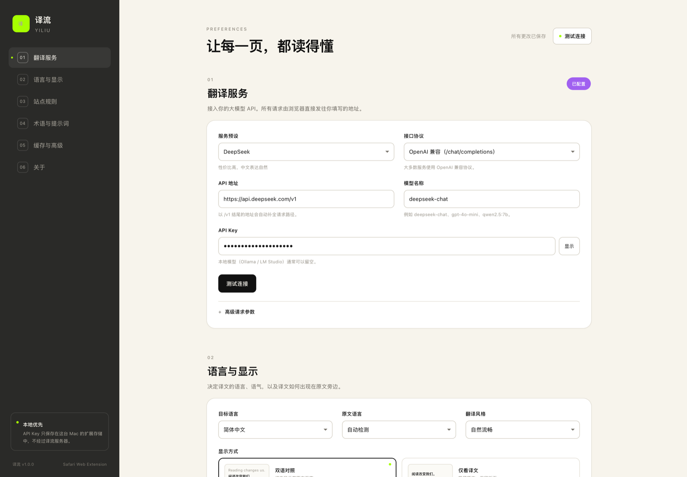
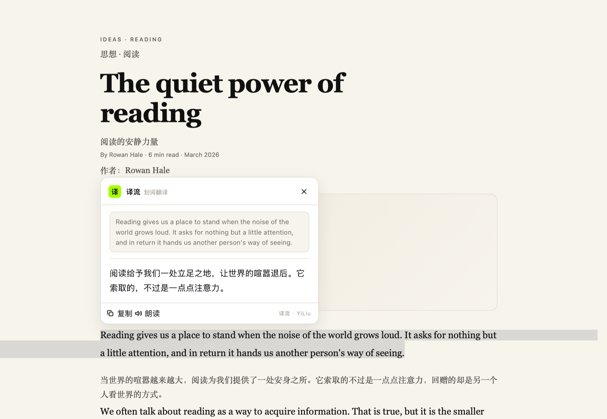
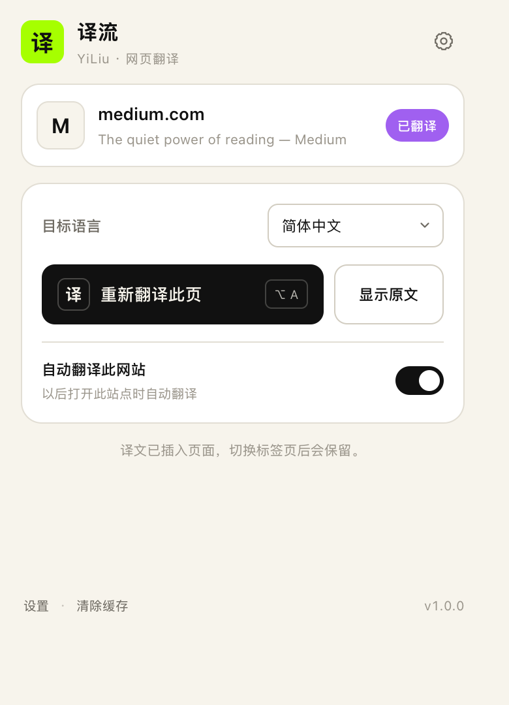
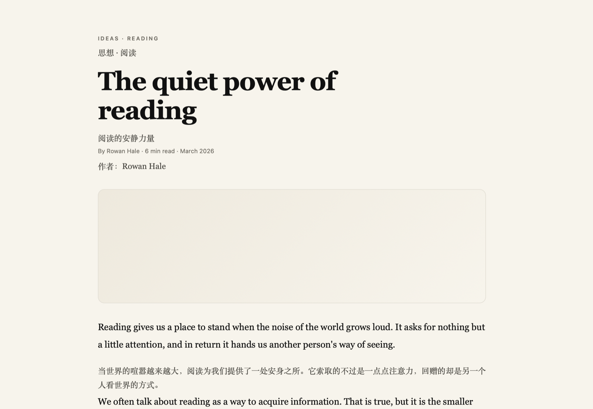
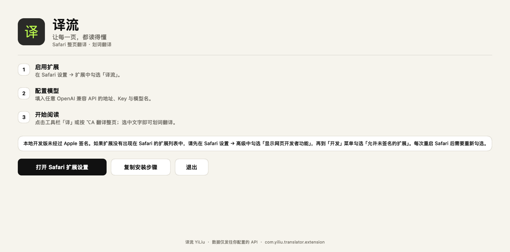

# 译流 YiLiu

> 用你自己的大模型 API，在 Safari 里翻译整个网页，或选中一段文字即时翻译。

译流是一个面向 Safari 的 WebExtension 翻译插件，参考了「沉浸式翻译」和「流畅阅读」的使用方式：**整页双语对照 / 仅看译文、划词翻译、按站点自动翻译、术语表、本地缓存**。它不绑定某一家模型服务，任何兼容 OpenAI `chat/completions` 的接口都可以接入，也支持 Anthropic Messages API。



## 功能

- **整页翻译**：自动识别正文段落，保留链接、加粗、行内代码等结构；译文以双语形式插入原文下方，也可切换为「仅看译文」。
- **划词翻译**：选中网页文字后浮出「译」按钮，点击后在原位弹出译文；可开启「选中后自动翻译」。
- **自己的模型**：DeepSeek、OpenAI、OpenRouter、硅基流动、Moonshot、智谱、Ollama、LM Studio、Anthropic，或任意自定义兼容接口。
- **按站点规则**：指定自动翻译的域名，或把站点加入排除列表；工具栏弹窗可一键开关当前站点。
- **省钱**：段落合并请求、并发控制、本地翻译缓存；相同模型 / 语言 / 风格 / 术语表不会重复请求。
- **术语表与提示词**：固定专有名词译法，追加自定义翻译风格。
- **隐私优先**：没有译流服务器，没有统计和遥测；API Key 只保存在本机扩展存储中，请求直接发往你配置的地址。
- **Safari 原生宿主**：自带一个 macOS 宿主 App 和 Safari Web Extension，构建脚本一键生成可直接打开的 `.app`。

| 划词翻译 | 工具栏弹窗 |
| --- | --- |
|  |  |

| 整页双语 | 安装引导 |
| --- | --- |
|  |  |

## 为什么没有直接复用现有项目

做技术选型时对比过两个参考项目：

- [Immersive Translate](https://github.com/immersive-translate/immersive-translate)：GitHub 仓库主要是文档和发布信息，没有客户端源码，也没有开源许可证，因此不能把官方客户端代码直接并入。
- [FluentRead](https://github.com/FluentRead/FluentRead)：开源，但使用 **GPL-3.0** 许可证，直接复用会要求整个项目以 GPL 开源；同时它是 Chrome/TypeScript 架构，迁移到 Safari 仍需要重做宿主 App、权限和 API 适配。

因此这里的实现是独立编写的，采用 MIT 许可证，保留了参考产品的工作流（整页双语、划词气泡、站点规则），但代码和 Safari 打包链路都是为这个项目量身做的。

## 品牌与界面规范

界面遵循亚雄 2026 数字端色彩规范：纸白 `#F7F4EC` 为页面底，墨黑 `#111111` 承担正文和主操作，暖灰 `#C6C2BA` 用于次级信息，炭灰 `#2A2A28` 只用于夜光表面；青柠 `#A6FF00` 仅作小面积高亮，莲紫 `#A060F0` 只用于状态胶囊/分类标签。没有青绿、天蓝、琥珀或渐变品牌色，主按钮统一为墨黑底纸白字，开关开启态为墨黑。设置页、工具栏弹窗、划词浮层和宿主 App 使用同一套 token。

## 快速开始

### 环境

- macOS 12 或更高，Safari 15 或更高
- Node.js 20+
- Xcode Command Line Tools（`xcode-select --install`）
- 不需要完整 Xcode；只有分发 / 上架时才需要 Apple 签名证书

### 构建并安装

```bash
npm install
npm test          # 39 个单元测试
npm run app       # 构建 extension/，并生成 dist/YiLiu.app
```

把 `dist/YiLiu.app` 拖进「应用程序」文件夹，双击打开。然后：

1. 在宿主 App 里点击「打开 Safari 扩展设置」。
2. Safari → 设置 → 扩展，勾选「译流」。
3. 如果列表里没有「译流」：先在 Safari → 设置 → 高级 勾选「显示网页开发者功能」，再到菜单栏「开发」→ 勾选「允许未签名的扩展」。
4. 打开扩展设置，填入 API 地址、Key 和模型，点击「测试连接」。

> **关于未签名扩展**：本仓库默认做 ad-hoc 签名，方便个人本地使用。Safari 会在每次重启后重置「允许未签名的扩展」，需要重新勾选。想要长期使用或分发，请使用 Apple Development / Developer ID 证书重新签名，见[签名与分发](#签名与分发)。

### 配置 DeepSeek（示例）

| 字段 | 值 |
| --- | --- |
| 服务预设 | DeepSeek |
| API 地址 | `https://api.deepseek.com/v1` |
| 模型 | `deepseek-chat` |
| API Key | 在 DeepSeek 开放平台创建 |

其他服务同理：选择预设会自动填入地址和模型；没有预设时选「自定义 / 兼容接口」，填入任意 OpenAI 兼容端点即可。Ollama、LM Studio 等本地服务默认不需要 API Key。

## 使用

### 整页翻译

- 点击 Safari 工具栏的「译」图标 →「翻译此页」。
- 或者按 `⌥ A`（可在 Safari 的扩展快捷键设置里修改）。
- 也可以在页面右键 →「译流：翻译此页面」。
- 页面右下角会显示进度，可随时停止。翻译完成后，弹窗里可「显示原文 / 重新翻译」。

### 划词翻译

- 用鼠标选中一段文字，点击浮出的「译」。
- 在设置 → 语言与显示中，可以开启「选中后自动翻译」，松开鼠标即弹出译文。
- 弹窗支持复制、朗读和重试；点击页面空白处或按 `Esc` 关闭。

### 按站点自动翻译

- 工具栏弹窗里打开「自动翻译此网站」。
- 或在设置 → 站点规则中填写域名，每行一个；`example.com` 会包含子域名，`*.example.com` 也可以。
- 排除列表中的网站不会自动翻译，手动点击也会被拦截。

## 开发

```bash
npm run build   # 打包到 extension/
npm test        # 单元测试（Node test + 内置 DOM 测试包）
npm run app     # 构建 macOS 宿主 App
npm run icons   # 重新生成图标（需要 Pillow，见下）
```

生成图标（可选，仓库已包含生成结果）：

```bash
python3 -m pip install --target .tools Pillow
npm run icons
```

### 目录结构

```
src/
  background/        # 后台页：消息路由、API 客户端、提示词、缓存
    api.js           # OpenAI 兼容 / Anthropic 适配、重试、错误映射
    prompt.js        # 整页 / 划词提示词，响应解析
    cache.js         # 本地翻译缓存
    index.js         # 扩展生命周期、菜单、快捷键、标签页命令
  content/
    dom.js           # 正文抽取、行内标记序列化 / 安全还原
    page.js          # 整页翻译调度、并发、动态内容监听
    selection.js     # 划词选择、气泡交互
    overlay.js       # Shadow DOM 浮层 UI
    content.css      # 注入页面的译文样式
  popup/             # 工具栏弹窗
  options/           # 设置页
  shared/            # 默认设置、常量、工具、存储封装
native/
  AppMain.m          # macOS 宿主 App
  SafariWebExtensionHandler.m
scripts/
  build.mjs          # esbuild 打包 WebExtension
  build-app.sh       # 组装、编译、签名、压缩 .app
tests/               # 39 个单元测试
```

### 一次整页翻译的流程

```
工具栏 / 快捷键 / 右键
        │
        ▼
background 确保 content script 已注入
        │  page.translate
        ▼
content 抽取叶子段落 → 序列化行内 <xN> 标记
        │  每批最多 10 段 / 6000 字符
        ▼
background 查本地缓存 → 未命中才请求模型
        │  OpenAI / Anthropic
        ▼
模型返回 JSON {translations:[{id,text}]}
        │
        ▼
content 安全还原链接 / 加粗 → 插入译文 → 进度
```

- 行内元素被替换成 `<x0>…</x0>` 标记，模型只负责搬运标记，HTML 标签由源 DOM 重新构造，因此模型输出无法注入脚本。
- 译文的链接只允许 `http(s)`、`mailto`、`tel` 和相对地址，`javascript:` 会被丢弃。
- 动态页面通过 `MutationObserver` 发现新增段落，进行增量翻译；上限为 1500 段，避免无限滚动的页面失控。

## 签名与分发

默认 ad-hoc 签名：

```bash
npm run app
```

使用 Apple 证书签名（需要钥匙串里已有有效证书）：

```bash
CODESIGN_IDENTITY="Apple Development: Your Name (TEAMID)" npm run app
```

脚本会：

1. 在临时目录里编译、组装 App 和 `.appex`；
2. 先签 `.appex`（带 sandbox + network client entitlement），再签外层 App；
3. 在临时目录完成 `codesign --verify`；
4. 复制到 `dist/YiLiu.app` 并压缩为 `dist/YiLiu-1.0.0.zip`。

要在 App Store 分发，还需要：

- 为宿主 App 和扩展分别创建 App ID 和 provisioning profile；
- 在 Xcode 中配置 Signing & Capabilities（App Sandbox、Safari Web Extension）；
- 把 `extension/` 的内容作为扩展 target 的 Resources；
- 遵守 Apple 的 App Store 审核要求。

也可以使用 Apple 官方的 `safari-web-extension-converter` 把 `extension/` 转成 Xcode 工程，再接入签名流程。

## 隐私与安全

- 没有后端、没有遥测、没有远程配置；扩展不会向译流作者发送任何数据。
- 整页翻译会把页面正文发送到你配置的模型 API；划词翻译只发送选中文字和少量上下文。
- API Key 存在 `browser.storage.local`，仅扩展进程可读。它不是钥匙串加密存储，请勿在共享 Mac 上使用长期 Key。
- 导出的设置文件默认去掉 API Key。
- 扩展使用 Manifest V2（Safari 当前仍支持），后台页只在需要时唤醒。
- 翻译结果只作为文本渲染；行内标签由源页面重建，不执行模型生成的 HTML。

## 已知限制

- Safari 内部页面（设置、扩展商店、起始页）不允许注入内容脚本，因此无法翻译。
- PDF、Canvas、图片中的文字、跨域 iframe 中的整页正文暂不支持自动翻译；划词翻译在可注入的 iframe 中可用。
- 使用 Shadow DOM 渲染正文的站点可能只翻译宿主元素中的文字。
- 页面自定义 CSS 可能影响译文排版；可以通过「译文样式 / 字号 / 颜色」调整。
- 部分服务商的 API 可能不允许浏览器直接跨域请求。译流已带 Anthropic 的浏览器直连头；如果其他服务仍拒绝，请使用其官方 CORS 代理或本地 OpenAI 兼容网关。
- 机器翻译的质量取决于你选择的模型。技术文档建议使用术语表，并选择较强的模型。
- `仅看译文` 使用透明文字隐藏原文，保留页面布局；极少数使用背景文字或伪元素的站点可能仍有残影。

## License

MIT
